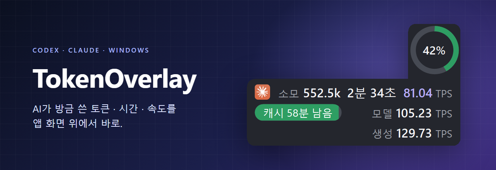
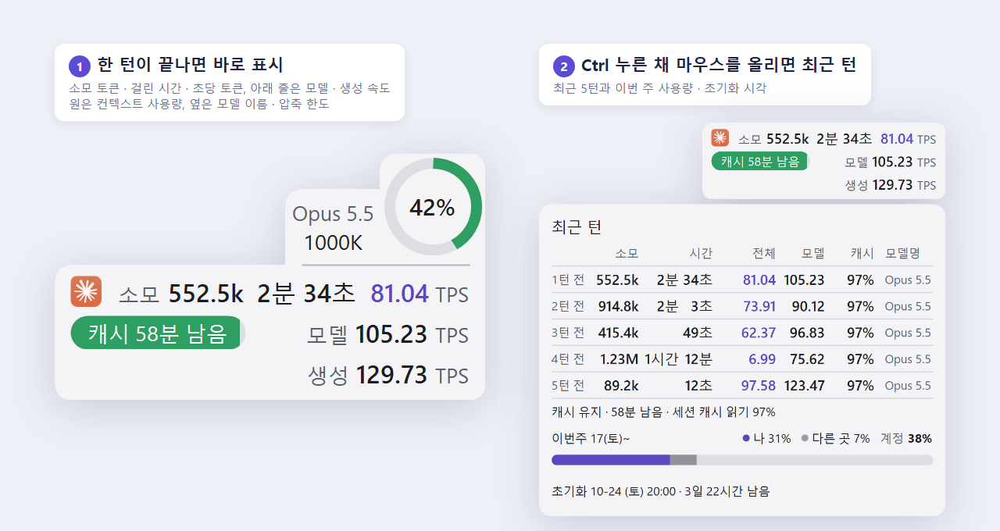
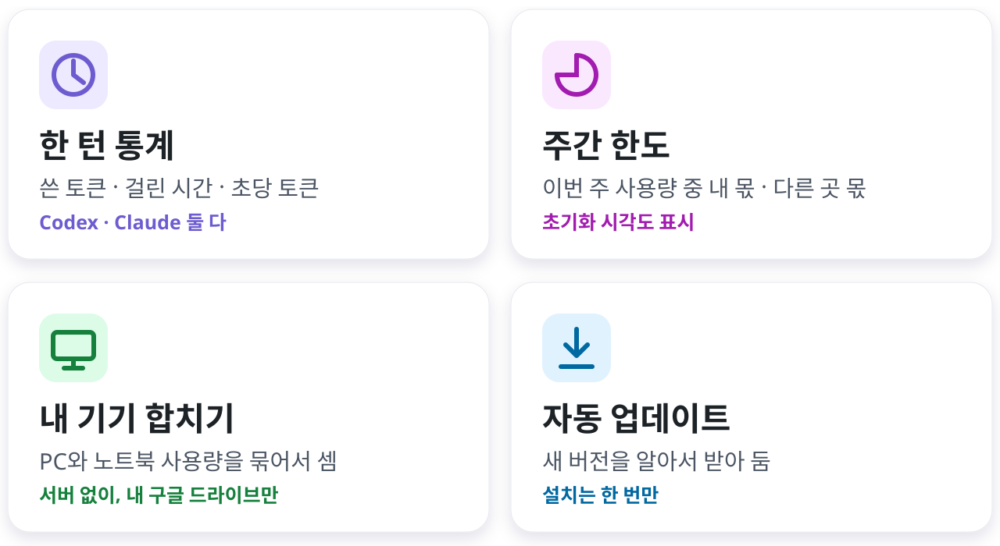
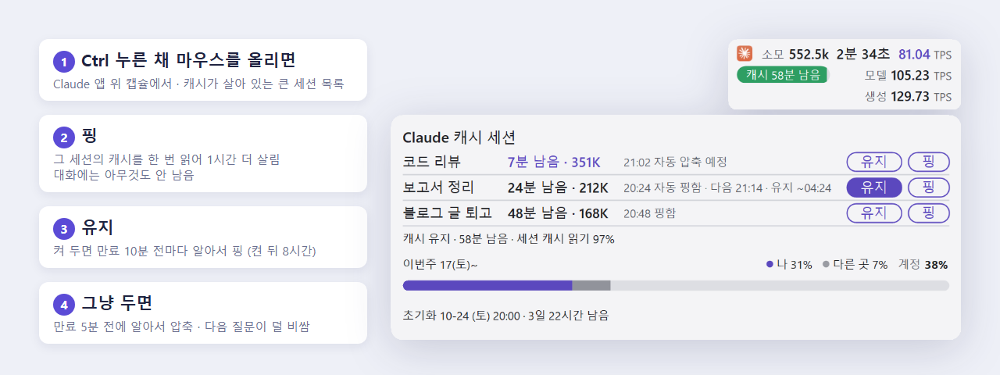

  

  
   
  Windows 10 · 11 (64비트) &nbsp;·&nbsp; 무료 &nbsp;·&nbsp; 설치 1분

 

  

  

## 설치

1. 위의 **초록 다운로드 버튼**을 누름
2. 받은 `TokenOverlay-win-Setup.exe`를 실행함
3. 끝. Codex나 Claude 앱을 켜면 창 위에 캡슐이 붙음

> [!TIP]
> **실행할 때 경고가 뜨면?** 개인이 만든 프로그램이라 처음 한 번 뜨는 정상 경고임.
> - 파란 창 **"Windows의 PC 보호"** → **추가 정보** 글자 누르기 → **실행**
> - 브라우저가 파일을 막으면 → 다운로드 목록에서 **⋯ → 유지**(Edge) 또는 **계속**(Chrome)

## 쓰는 법

- 트레이(화면 오른쪽 아래 시계 옆 `^`)에 있는 아이콘을 누르면 설정 메뉴가 나옴.
- 캡슐을 누르면 방금 끝난 턴을 자세히 보여 줌.
- **Ctrl**을 누른 채 캡슐에 마우스를 올리면 최근 턴과 이번 주 사용량이 펼쳐짐. Claude에서 아래 확장을 켰으면 최근 턴 자리에 캐시 세션 목록이 뜸.
- 캡슐 아래 줄: **모델** = 도구 실행 시간을 뺀 속도, **생성** = 첫 토큰 대기까지 뺀 속도. 설정 메뉴에서 줄마다 끌 수 있음.
- PC와 노트북을 같이 쓰면 메뉴의 **내 기기 공유 (구글 드라이브)** 를 켜 둠. 두 기기 사용량을 합쳐서 "나"로 셈.
- 업데이트는 자동임. 새 버전이 준비되면 메뉴 맨 위에 **업데이트 적용 · 재시작** 이 생김.

## Claude 캐시 지키기 (선택)

  

Claude는 한 대화에 1시간 동안 요청이 없으면 그 대화의 캐시를 지움. 그 뒤에 메시지를 보내면 대화 전체를 다시 저장해서, 대화가 길수록 사용량이 크게 나감. 오버레이에 같이 들어 있는 Claude Code 확장을 켜면 이걸 막을 수 있음.

**켜는 법**

1. 트레이 아이콘 → **설정** → **Claude Code 확장 (핑·자동 압축)** 을 누름
2. 확인창에서 **확인** 을 누름
3. 그 뒤에 새로 여는 세션부터 적용됨. 이미 열려 있던 세션은 그 채팅창에 `/reload-plugins` 를 한 번 침

- 15만 토큰이 넘는 세션만 목록에 뜨고, 자동 압축도 그런 세션만 함.
- 핑 한 번은 그 세션의 캐시를 한 번 읽는 만큼 사용량을 씀. 캐시가 지워진 뒤 다시 저장하는 값의 약 20분의 1임.
- 목록에 **새 버전 · /reload-plugins 치면 적용** 이 뜨면 오버레이와 함께 확장이 업데이트된 것임. 그 세션 채팅창에 `/reload-plugins` 를 치면 됨.
- 같은 목록은 트레이 → **설정** → **Claude 캐시 세션…** 에서도 열 수 있음.
- 메뉴가 회색이면 Claude 데스크톱 앱에서 **Code** 탭을 한 번 연 뒤 다시 누름.
- 확장을 켜면 Claude Code 설정에 확장이 등록됨. 같은 메뉴를 다시 누르면 꺼지고 등록도 지워짐.

<b>안 될 때 (버그 신고)</b>

 

1. 트레이 메뉴 → 설정 → **버그 신고용 로그 만들기** 를 누름.
2. 바탕화면에 생긴 `TokenOverlay-log-….zip`을 만든 사람에게 보냄.

로그에 대화 내용과 계정 정보는 들어가지 않음. 채팅 제목은 글자 수만 남고, 사용자 폴더 이름은 가려짐.

<b>개인정보</b>

 

- 기록은 내 PC(`%APPDATA%\TokenOverlay`)에만 저장됨. 내 기기 공유를 켜면 내 구글 드라이브에도 저장됨. 외부 서버로 보내는 건 없음.
- 앱 연결을 켜면 Codex·Claude 앱의 사용 기록을 이 PC 안에서만 받아 속도를 계산함. 질문 내용은 받지 않음.
- 기기 구별에는 Windows 기기 고유값을 변환한 짧은 ID를 씀. 계정 정보는 쓰지 않음.
- Claude Code 확장은 켰을 때만 이 PC의 Claude Code 안에서 돌고, 오버레이와는 `%APPDATA%\TokenOverlay\cache-bridge` 폴더의 작은 파일로만 주고받음. 핑과 압축은 그 세션 안에서 내 Claude 계정으로 실행됨.

<b>지우기</b>

 

Windows 설정 → 앱 → 설치된 앱 → **TokenOverlay** 옆 `⋯` → **제거**.
자동 실행, 앱 연결, Claude Code 확장 등록도 함께 원래대로 되돌림. 기록 폴더 `%APPDATA%\TokenOverlay`는 남으니, 필요 없으면 직접 지우면 됨.

 

<a href="https://github.com/soleillevant0125/codex-token-overlay">soleillevant0125/codex-token-overlay</a>(MIT)를 바탕으로 igayowai가 만듦 · <a href="LICENSE">LICENSE</a>

